# Clean Architecture TODO App

[](https://github.com/ctorrez/todo_app/actions)


A minimal, production-grade TODO application built in Python demonstrating **Clean Architecture (Ports & Adapters / Hexagonal)**, the **Repository Pattern**, **Domain-Driven Design (DDD)** concepts, and **Clean Seams**. Features **Local AI Natural Language Ingestion** (Powered by Ollama) and **Local Semantic Vector Search** (Powered by Ollama + NumPy).

---

## Architecture Overview

This project separates business rules from frameworks and I/O. The domain and application layers have zero external dependencies, making the core portable and testable without mocks or databases.

```mermaid
flowchart TD
    subgraph Presentation ["Presentation Layer (Inbound Adapters)"]
        CLI["Interactive Menu (cli.py)"]
        AgentCLI["Command Handler & JSON (command_handler.py)"]
    end

    subgraph Application ["Application Layer (Use Cases & Ports)"]
        Services["Services / Use Cases\n(UserService, TaskService)"]
        RepoPorts["Repository Ports\n(UserRepository, TaskRepository)"]
        AIPort["AI Parser Port\n(TaskParserPort)"]
        VectorPorts["Vector Ports\n(TaskEmbeddingPort, TaskVectorRepository)"]
    end

    subgraph Domain ["Domain Layer (Core)"]
        Entities["Domain Models & Value Objects\n(User, Task, ParsedTask, ScoredTask, Priority, TaskStatus)"]
        Exceptions["Domain Exceptions\n(UserNotFoundError, TaskNotFoundError)"]
    end

    subgraph Infrastructure ["Infrastructure Layer (Outbound Adapters)"]
        SqlRepo["SQLAlchemy 2.0 Repositories\n(SqlAlchemyUserRepository, SqlAlchemyTaskRepository)"]
        VectorRepo["SQLAlchemy Vector Store\n(SqlAlchemyTaskVectorRepository - BLOB + NumPy SIMD)"]
        MemRepo["In-Memory Repositories\n(InMemoryUserRepository, InMemoryTaskRepository, InMemoryTaskVectorRepository)"]
        OllamaAdapter["Local AI Parser Adapter\n(OllamaTaskParser - llama3.2:1b)"]
        OllamaEmbedder["Local Embedder Adapter\n(OllamaTaskEmbedder - all-minilm)"]
        MockAIAdapter["Mock AI Adapters\n(MockTaskParser, MockTaskEmbedder)"]
        DB[(SQLite / Database Engine)]
    end

    CLI --> Services
    AgentCLI --> Services
    Services --> Entities
    Services --> RepoPorts
    Services --> AIPort
    Services --> VectorPorts
    SqlRepo -.->|implements| RepoPorts
    VectorRepo -.->|implements| VectorPorts
    MemRepo -.->|implements| RepoPorts
    MemRepo -.->|implements| VectorPorts
    OllamaAdapter -.->|implements| AIPort
    OllamaEmbedder -.->|implements| VectorPorts
    MockAIAdapter -.->|implements| AIPort
    MockAIAdapter -.->|implements| VectorPorts
    SqlRepo --> DB
    VectorRepo --> DB
```



For an in-depth breakdown of design decisions, boundaries, and SOLID principles, see [ARCHITECTURE.md](ARCHITECTURE.md).

---

## Key Highlights

- **Light Clean Architecture**: Eliminates enterprise boilerplate while strictly enforcing the Dependency Rule.
- **Local AI Natural Language Extraction**: Integrates local self-hosted SLMs (Meta Llama 3.2 1B via Ollama) with 100% privacy and zero cloud fees.
- **Local Semantic Vector Search (RAG Seam)**: Converts tasks into 384-dimensional dense vectors using Ollama (`all-minilm`), stored in SQLite as binary BLOBs and queried using NumPy SIMD matrix cosine similarity with zero cloud fees.
- **Rich Domain Modeling (DDD)**: Encapsulated business rules in entities (`Task.is_overdue`, `Task.is_due_today`, `Priority` enum, state transitions).
- **Clean Seams**: Abstract repository, AI parser, and vector store ports decouple use cases from external technology.
- **Mock-Free Unit Testing**: In-memory repository adapters and mock AI parsers/embedders allow 100% test coverage of domain logic and use cases in fractions of a second without mock libraries or external API calls.
- **Modern SQLAlchemy 2.0**: Declarative ORM models mapped cleanly to/from pure domain dataclasses.
- **Dual Presentation**: Interactive menu for humans and non-interactive JSON subcommands for AI agents (e.g. Antigravity `agy`).
- **Composition Root**: Centralized bootstrap in [`app.py`](app.py) where dependencies are injected.
- **Continuous Integration**: Automated GitHub Actions workflow running tests, coverage, ruff, and strict mypy type-checking on every push.

---

## Local Semantic Vector Search (RAG Seam)

We have implemented local semantic vector search using **Clean Architecture Ports & Adapters**, **Ollama (`all-minilm`)**, and **NumPy SIMD vector math over SQLite BLOB storage**.

---

### 1. The Clean Architecture Seams

#### A. Domain Value Object ([`src/todo/domain/models.py`](src/todo/domain/models.py))

```python
# --- Domain Value Object ---


@dataclass(frozen=True)
class ScoredTask:
    """A task paired with a similarity or relevance score (0.0 to 1.0)."""

    task: Task
    score: float
```

#### B. Application Port 1: Embedding Generator ([`src/todo/application/ports.py`](src/todo/application/ports.py))

```python
# --- Application Port 1: Embedding Generator ---
# Adapters: OllamaEmbeddingAdapter, FastEmbedAdapter, OpenAIEmbeddingAdapter


class TaskEmbeddingPort(ABC):
    """Abstract port for converting text into normalized vector embeddings."""

    @abstractmethod
    def embed_text(self, text: str) -> Vector: ...

    @abstractmethod
    def embed_batch(self, texts: list[str]) -> list[Vector]: ...
```

#### C. Application Port 2: Vector Storage & Retrieval ([`src/todo/application/ports.py`](src/todo/application/ports.py))

```python
# --- Application Port 2: Vector Storage & Retrieval ---
# Adapters: SqliteVectorRepository (now), Qdrant / Chroma / Pinecone (later)


class TaskVectorRepository(ABC):
    """Abstract port for storing and performing similarity searches over task embeddings."""

    @abstractmethod
    def upsert_vector(self, task_id: int, user_id: int, vector: Vector) -> None: ...

    @abstractmethod
    def upsert_batch(self, items: list[tuple[int, int, Vector]]) -> None: ...

    @abstractmethod
    def search_similar(
        self,
        query_vector: Vector,
        user_id: int,
        limit: int = 5,
        threshold: float = 0.5,
    ) -> list[tuple[int, float]]: ...

    @abstractmethod
    def delete_vector(self, task_id: int) -> None: ...
```

---

### 2. Adapters Built

1. **`OllamaTaskEmbedder`**: Hits local Ollama (`POST /api/embed` with `all-minilm` 384 dimensions) with L2 vector normalization.
2. **`MockTaskEmbedder`**: Deterministic, fast hash embedder for unit tests requiring zero external dependencies or network.
3. **`SqlAlchemyTaskVectorRepository`**: Stores float32 binary BLOBs in SQLite and performs vectorized NumPy cosine matrix multiplication in C/SIMD.
4. **`InMemoryTaskVectorRepository`**: In-memory dictionary vector store for offline unit tests.

---

### 3. Live Demonstration

#### Concept Search: `"medical appointments"` (Zero exact word overlap)

```powershell
python app.py tasks search "medical appointments"
```

Output:
```text
Semantic Search Results for 'medical appointments':
  [ ] #2 [HIGH] [Match: 41%] - Take Grace to pediatrician
       Annual wellness exam
  [ ] #1 [HIGH] [Match: 34%] - Schedule dental checkup with Dr. Miller
       Ask about teeth whitening
```
*(Notice: Grocery shopping and software tasks were automatically excluded).*

#### Concept Search: `"groceries food"`

```powershell
python app.py tasks search "groceries food"
```

Output:
```text
Semantic Search Results for 'groceries food':
  [ ] #3 [LOW] [Match: 34%] - Buy almond milk and sourdough bread
       Visit Whole Foods
```

#### Machine Output for AI Agents (`--json`):

```powershell
python app.py tasks search "medical checkup" --json
```

Output:
```json
{
  "status": "success",
  "data": [
    {
      "task": {
        "id": 2,
        "title": "Take Grace to pediatrician",
        "priority": "HIGH"
      },
      "similarity_score": 0.3526
    }
  ]
}
```

---

## Project Structure

```text
todo_app/
├── .github/workflows/ci.yml       # Automated GitHub Actions CI (Ruff, Mypy, Pytest)
├── Sessions/                      # Workflow notes, experiment logs, and local AI setup
│   ├── OllamaSetup.md             # Local Ollama installation & Windows CPU guide
│   └── AIPromptTestingGuide.md    # Verified prompt test cases & SLM techniques
├── src/
│   └── todo/
│       ├── domain/                # Pure business logic (Zero dependencies)
│       │   ├── models.py          # User, Task, ParsedTask, ScoredTask, Priority
│       │   └── exceptions.py      # Domain exceptions
│       ├── application/           # Use cases & abstract ports
│       │   ├── ports.py           # UserRepository, TaskRepository, TaskEmbeddingPort, TaskVectorRepository
│       │   └── services.py        # UserService & TaskService (Semantic search, backfill)
│       ├── infrastructure/        # Outbound adapters (persistence & AI)
│       │   ├── db.py              # SQLAlchemy 2.0 models & session factory
│       │   ├── sqlite_repos.py    # Production SQLite & Vector repositories
│       │   ├── memory_repos.py    # In-memory repositories & vector store for tests
│       │   └── ai/                # AI adapters
│       │       ├── ollama_parser.py   # Local Ollama Llama 3.2 1B task parser
│       │       ├── ollama_embedder.py # Local Ollama all-minilm vector embedder
│       │       ├── mock_parser.py     # Deterministic mock parser for tests
│       │       └── mock_embedder.py   # Deterministic mock embedder for tests
│       └── presentation/          # Inbound adapters (UI)
│           ├── cli.py             # Interactive menu for humans
│           └── command_handler.py # Non-interactive & JSON interface for AI agents
├── tests/
│   ├── unit/                      # Blazing-fast unit tests (In-Memory + Mock AI)
│   └── integration/               # Integration tests (SQLite & Vector storage)
├── app.py                         # Composition Root & application entrypoint
├── pyproject.toml                 # Modern Python build & tool configuration
├── requirements.txt               # Dependencies
├── ARCHITECTURE.md                # In-depth architectural documentation
└── README.md
```

---

## Getting Started

### 1. Prerequisites
- Python 3.11 or higher

### 2. Setup Virtual Environment

```powershell
# Create virtual environment
python -m venv .venv

# Activate it (Windows PowerShell)
.\.venv\Scripts\Activate.ps1

# Install dependencies
pip install -r requirements.txt
```

### 3. Run the Application

#### Interactive Mode (for humans)
```powershell
python app.py
```

#### Non-Interactive & AI Agent Mode (JSON output)
AI agents (e.g. Antigravity `agy`) or automated scripts can run commands with subcommands and `--json`:

```powershell
# List registered users
python app.py users list --json

# Register a user
python app.py users add --first Ada --last Lovelace --email ada@example.com --json

# Add a task with priority and due date (supports YYYY-MM-DD or MM/DD/YYYY)
python app.py tasks add --title "Publish github profile" --priority urgent --due 10/18/2026 --json

# List tasks (filter by status, priority, or overdue)
python app.py tasks list --status pending --priority urgent --json
python app.py tasks list --overdue --json
python app.py tasks list --due-today --json

# Complete or reopen a task
python app.py tasks complete 1 --json
python app.py tasks reopen 1 --json

# Delete a task
python app.py tasks delete 1 --json
```

#### Local AI Natural Language Ingestion (Powered by Ollama)
Extract structured tasks directly from natural language using 100% private, local LLMs (`llama3.2:1b`):

```powershell
# Preview what the local AI extracts (does not save to DB)
python app.py ai parse "Urgent meeting with Sarah tomorrow at 2pm to review budget"

# Automatically extract and save the task to the database
python app.py ai add "Dentist appointment this Friday morning"

# AI output as structured JSON for agents
python app.py ai add "Dentist appointment this Friday morning" --json
```

#### Local Semantic Vector Search (Powered by Ollama + NumPy)
Search tasks conceptually by meaning without requiring exact keyword matches:

```powershell
# Perform semantic search with cosine similarity
python app.py tasks search "medical appointments"

# Adjust similarity threshold (default is 0.15) and limit
python app.py tasks search "groceries food" --threshold 0.20 --limit 3

# Return structured JSON for agent integration
python app.py tasks search "medical checkup" --json

# Reindex all tasks if embeddings need backfilling
python app.py tasks reindex
```

---

## Running Tests & Quality Checks

### Run Test Suite with Coverage
```powershell
pytest -v
```

### Run Strict Type Checking
```powershell
mypy src
```

### Run Linter & Code Formatter
```powershell
ruff check src tests
```

---

## Use Cases Covered

- **User Registration**: Register users with email uniqueness and format validation.
- **User Switching**: Switch active user session.
- **Task Management**: Create tasks with priorities (`LOW`, `MEDIUM`, `HIGH`, `URGENT`), descriptions, and due dates.
- **Task Filtering**: Filter by status (all, pending, completed), priority, or overdue / due today flags.
- **Local Semantic Search**: Search tasks conceptually by meaning using cosine vector similarity with Ollama embeddings and SQLite BLOB storage.
- **Task Completion**: Complete, reopen, or delete tasks.
- **Agent Integration**: Non-interactive CLI with structured JSON responses for LLMs and automation.
- **Error Handling**: Graceful domain error handling with user-friendly messages.
