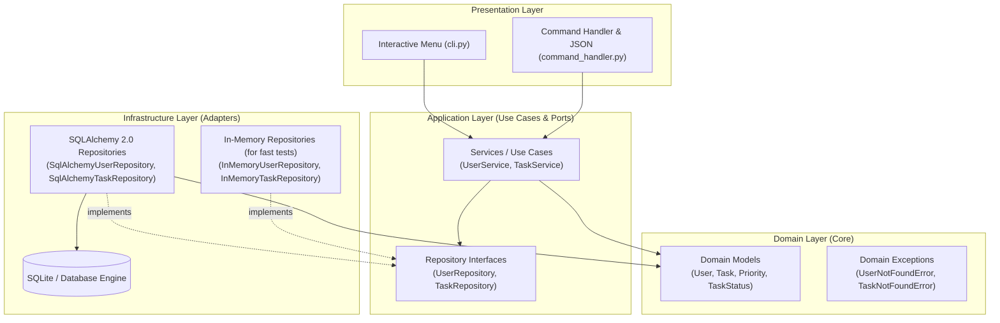

# Clean Architecture TODO App

[](https://github.com/ctorrez/todo_app/actions)


A minimal, production-grade TODO application built in Python demonstrating **Clean Architecture (Ports & Adapters / Hexagonal)**, the **Repository Pattern**, **Domain-Driven Design (DDD)** concepts, and **Clean Seams**.

---

## Architecture Overview

This project separates business rules from frameworks and I/O. The domain and application layers have zero external dependencies, making the core portable and testable without mocks or databases.



For an in-depth breakdown of design decisions, boundaries, and SOLID principles, see [ARCHITECTURE.md](ARCHITECTURE.md).

---

## Key Highlights

- **Light Clean Architecture**: Eliminates enterprise boilerplate while strictly enforcing the Dependency Rule.
- **Rich Domain Modeling (DDD)**: Encapsulated business rules in entities (`Task.is_overdue`, `Task.is_due_today`, `Priority` enum, state transitions).
- **Clean Seams**: Abstract repository ports (`UserRepository`, `TaskRepository`) decouple use cases from persistence details.
- **Mock-Free Unit Testing**: In-memory repository adapters allow 100% test coverage of domain logic and use cases in fractions of a second without mock libraries.
- **Modern SQLAlchemy 2.0**: Declarative ORM models mapped cleanly to/from pure domain dataclasses.
- **Dual Presentation**: Interactive menu for humans and non-interactive JSON subcommands for AI agents (e.g. Antigravity `agy`).
- **Composition Root**: Centralized bootstrap in [`app.py`](app.py) where dependencies are injected.
- **Continuous Integration**: Automated GitHub Actions workflow running tests, coverage, ruff, and strict mypy type-checking on every push.

---

## Project Structure

```text
todo_app/
├── .github/workflows/ci.yml       # Automated GitHub Actions CI (Ruff, Mypy, Pytest)
├── src/
│   └── todo/
│       ├── domain/                # Pure business logic (Zero dependencies)
│       │   ├── models.py          # User, Task, Priority, TaskStatus dataclasses
│       │   └── exceptions.py      # Domain exceptions
│       ├── application/           # Use cases & abstract ports
│       │   ├── ports.py           # UserRepository & TaskRepository ABCs
│       │   └── services.py        # UserService & TaskService
│       ├── infrastructure/        # Outbound adapters (persistence)
│       │   ├── db.py              # SQLAlchemy 2.0 models & session factory
│       │   ├── sqlite_repos.py    # Production SQLite repositories
│       │   └── memory_repos.py    # In-memory repositories for tests
│       └── presentation/          # Inbound adapters (UI)
│           ├── cli.py             # Interactive menu for humans
│           └── command_handler.py # Non-interactive & JSON interface for AI agents
├── tests/
│   ├── unit/                      # Blazing-fast unit tests (In-Memory)
│   └── integration/               # Integration tests (SQLite)
├── app.py                         # Composition Root & application entrypoint
├── pyproject.toml                 # Modern Python build & tool configuration
├── requirements.txt               # Dependencies
├── ARCHITECTURE.md                # In-depth architectural documentation
└── README.md
```

---

## Getting Started

### 1. Prerequisites
- Python 3.11 or higher

### 2. Setup Virtual Environment

```powershell
# Create virtual environment
python -m venv .venv

# Activate it (Windows PowerShell)
.\.venv\Scripts\Activate.ps1

# Install dependencies
pip install -r requirements.txt
```

### 3. Run the Application

#### Interactive Mode (for humans)
```powershell
python app.py
```

#### Non-Interactive & AI Agent Mode (JSON output)
AI agents (e.g. Antigravity `agy`) or automated scripts can run commands with subcommands and `--json`:

```powershell
# List registered users
python app.py users list --json

# Register a user
python app.py users add --first Ada --last Lovelace --email ada@example.com --json

# Add a task with priority and due date (supports YYYY-MM-DD or MM/DD/YYYY)
python app.py tasks add --title "Publish github profile" --priority urgent --due 10/18/2026 --json

# List tasks (filter by status, priority, or overdue)
python app.py tasks list --status pending --priority urgent --json
python app.py tasks list --overdue --json
python app.py tasks list --due-today --json

# Complete or reopen a task
python app.py tasks complete 1 --json
python app.py tasks reopen 1 --json

# Delete a task
python app.py tasks delete 1 --json
```

---

## Running Tests & Quality Checks

### Run Test Suite with Coverage
```powershell
pytest -v
```

### Run Strict Type Checking
```powershell
mypy src
```

### Run Linter & Code Formatter
```powershell
ruff check src tests
```

---

## Use Cases Covered

- **User Registration**: Register users with email uniqueness and format validation.
- **User Switching**: Switch active user session.
- **Task Management**: Create tasks with priorities (`LOW`, `MEDIUM`, `HIGH`, `URGENT`), descriptions, and due dates.
- **Task Filtering**: Filter by status (all, pending, completed), priority, or overdue / due today flags.
- **Task Completion**: Complete, reopen, or delete tasks.
- **Agent Integration**: Non-interactive CLI with structured JSON responses for LLMs and automation.
- **Error Handling**: Graceful domain error handling with user-friendly messages.
